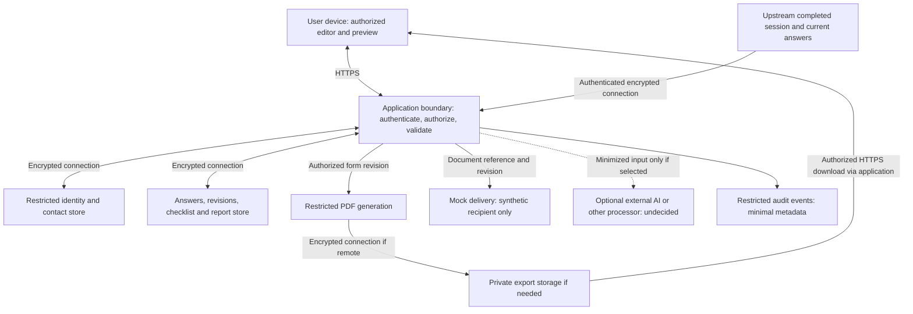

# PII security and privacy design

Status: proposed baseline, updated 2026-10-31. Kim selected the shared stack with Clerk; an application scaffold and explicitly synthetic forms renderer have been added alongside the earlier prototype. Deployment, live authentication, private profile persistence and real payloads remain unresolved. Controls below are requirements to verify against those real boundaries, not a compliance assessment. Scoped local evidence is recorded in `docs/team/status/kim.md`.

Scope follows [the form workstream](form-workstream.md): completed session -> checklist -> mobile report -> profile editing -> preview/PDF -> mock delivery. The upstream session service, any processors, and downstream copies belong in the security review even when another workstream owns them.

## Supplied sensitivity context

Kim clarified that sessions/forms will probably contain the information needed to complete Vietnamese legal procedures and documents, and may therefore be quite sensitive. Exact procedures, fields, and attachments are not yet confirmed. Treat personal dossiers, free text, and derived documents as highly confidential for engineering purposes until the field inventory is agreed. This is a conservative handling rule, not a statutory classification of every field.

Collect only the information required by the selected procedure; avoid a general-purpose collection of every possible personal detail. Identity numbers, household relationships, financial circumstances, health information, signatures, and supporting scans are possible categories to investigate, not confirmed project fields. Hosting and data-residency constraints remain unanswered.

Keep verified public legal references and blank templates separate from private user submissions and completed documents. Private content must not enter a shared public-reference corpus, demonstration dataset, or training pipeline. Any private search/retrieval must enforce owner/tenant permissions before content is returned or included in model context.

Add a Vietnam-specific privacy review to the implementation handoff. An official starting point is [Law 91/2025/QH15 on Personal Data Protection](https://chinhphu.vn/?pageid=27160&docid=214590), effective 1 January 2026. The privacy owner should check the applicable implementing rules, field classifications, organizational roles, grounds for processing, notices, and any assessment or transfer requirements for the actual service. No legal conclusion about those obligations or mandatory hosting location is established here.

## Protection model

Personalized official forms and delivered PDFs need identifying information and remain PII. Encryption protects confidentiality; pseudonymization replaces identifiers while permitting linkage. Neither establishes anonymity. Free text and combinations of indirect identifiers can also identify someone. Any future dataset described as anonymous needs a documented assessment of re-identification risk for its intended recipients and use. [NIST SP 800-188](https://nvlpubs.nist.gov/nistpubs/SpecialPublications/NIST.SP.800-188.pdf)

For this application, propose keeping identity/contact data logically separate from answers and workflow records, linked by random internal identifiers. Restrict the identity lookup to operations that need it, such as editing the profile, filling the official form, or contacting the intended recipient. The linked records still require PII protections. This is a design proposal, not a payload contract or database choice.

## Proposed data flow and trust boundaries

Boxes are logical responsibilities; they do not require separate services. The PDF location and persistence model are undecided. Apply encrypted transport to every network hop, including processor, audit, queue, and backup connections not individually drawn. A real delivery provider would introduce another trust boundary; mock delivery makes no external send.

Record the actual field inventory before integrating real payloads: source, purpose, sensitivity, required recipients, storage locations/region, retention period, deletion behavior, and accountable owner. Names, contact details, identity documents, recordings, and sensitive answers are examples to confirm, not established fields in this project. Raw transcripts or recordings, if they exist upstream, require their own justification; form generation does not automatically justify copying or retaining them.

## Encryption and key handling

- **In transit:** propose TLS 1.3 by default, TLS 1.2 only where compatibility requires it, valid certificate checking, and no plaintext fallback. Protect internal API/database/worker connections as well as the public site. [OWASP TLS guidance](https://cheatsheetseries.owasp.org/cheatsheets/Transport_Layer_Security_Cheat_Sheet.html)
- **At rest:** require encryption for databases, object storage, queues, temporary PDF files, snapshots, and backups. Verify configuration and access policies rather than assuming hosting defaults. Evaluate application-level authenticated encryption for especially sensitive fields once the threat model and fields are known; use maintained cryptographic libraries, for example AES-GCM with library-managed nonce handling. Storage encryption alone does not protect against an authorized database read. [OWASP cryptographic storage guidance](https://cheatsheetseries.owasp.org/cheatsheets/Cryptographic_Storage_Cheat_Sheet.html)
- **Keys:** use the selected platform's managed key service and secret store, with access separate from data access and scoped to the required workload. Keep keys out of source code, frontend bundles, logs, and database rows containing plaintext keys. Define owners for key access, rotation, compromise response, recovery, and retirement; test rotation and recovery before depending on them. Separate development and production keys and access. [OWASP key management guidance](https://cheatsheetseries.owasp.org/cheatsheets/Key_Management_Cheat_Sheet.html)

The application and PDF renderer will need plaintext during processing. Keep that processing limited to authorized workloads, minimize its duration, and restrict diagnostic dumps. This design does not claim end-to-end encryption that hides data from the application or its selected processors.

## Access, browser state, and document handling

- Deny access by default. Enforce ownership and allowed actions on the server for every session read, save, report, preview, PDF, deletion, and delivery request, including background jobs. Add tenant scope if the product is multi-tenant. Random IDs supplement authorization; they do not replace it. Administrative/support access must be explicitly scoped and audited. [OWASP authorization guidance](https://cheatsheetseries.owasp.org/cheatsheets/Authorization_Cheat_Sheet.html)
- Keep form PII in short-lived browser memory by default. Do not persist it in local/session storage, IndexedDB, or service-worker caches. Clear editor state, pending requests, preview data, and object URLs on session change/logout; ignore late responses belonging to the previous session. Browser storage does not provide a confidentiality boundary against hostile same-origin scripts or device access. [OWASP browser storage guidance](https://cheatsheetseries.owasp.org/cheatsheets/HTML5_Security_Cheat_Sheet.html)
- Proposed form-specific safeguards: serve sensitive responses with `Cache-Control: no-store`; exclude them from shared/CDN caching; use generic filenames and no PII in URLs. For cookie-based authentication, use Secure/HttpOnly cookies, an appropriate SameSite policy, and CSRF protection for state changes. Choose the exact authentication/session design with the stack.
- Treat all answers and procedure text as untrusted input. Encode preview content safely; prevent executable markup, PDF scripts, template injection, and renderer access to user-controlled network/file locations. Use trusted templates/assets and limit the renderer's permissions and network access. Review dependencies when the renderer is chosen.
- Generate exports from the authorized current form revision. Use private storage if exports must persist and prefer authenticated downloads that recheck access. Define expiry, revocation, and obsolete-revision handling; if signed links are considered, account for forwarding and their revocation limits. A downloaded PDF is a separate PII copy outside application revocation control.
- Keep unnecessary identifiers out of document metadata, hidden fields, attachments, and filenames. If a redacted export is later needed, remove underlying text/fields rather than drawing opaque boxes over it; verify extracted text and metadata as well as appearance.

## Minimization, AI processing, and observability

Use synthetic fixtures for development, demos, screenshots, and CI; do not copy real sessions into the repository or review prompts. For operational processing, select only fields needed for the task. Redact identifiers from free text as well as structured fields where identity is unnecessary; do not use plain hashes of phone numbers or other guessable identifiers as an anonymity claim. For later analytics, prefer aggregate outputs with rare combinations suppressed and assess remaining disclosure risk. [NIST de-identification guidance](https://nvlpubs.nist.gov/nistpubs/SpecialPublications/NIST.SP.800-188.pdf)

If an external AI service is used, first document the provider, processing location, subprocessors, retention/deletion, training use, and actual configuration/contract. Send only the necessary content; use pseudonymous references where possible and insert identity fields into the final form inside the trusted application boundary. Redaction can miss contextual identifiers. Treat model inputs/outputs as potentially sensitive and untrusted; a model must not control record authorization, recipient selection, or delivery. This is conditional design, not a selected AI integration.

If uploads or OCR are introduced, protect originals, extracted text, thumbnails, signatures, barcodes/QR codes, metadata, and processor copies under the same access, encryption, and deletion rules. Restrict file types/size and isolate parsing/OCR; extracted text remains untrusted. If retrieval/embeddings are introduced, include chunks, vectors, indexes, and response caches in that lifecycle. Embeddings do not establish anonymity; enforce permissions during retrieval and propagate source deletion/revocation to derived copies. These components are not selected by this proposal. [OWASP RAG security guidance](https://cheatsheetseries.owasp.org/cheatsheets/RAG_Security_Cheat_Sheet.html)

Use an allowlist of audit fields: action, opaque actor/resource reference, time, outcome, and necessary revision reference. Exclude answers, profile values, document bodies, prompts/responses, contact details, authentication tokens, and signed URLs from application/proxy logs, traces, crash reports, and analytics. Disable session replay and automatic request-body capture on PII routes. Audit references may themselves be linkable personal data; restrict their access and retention. [OWASP logging guidance](https://cheatsheetseries.owasp.org/cheatsheets/Logging_Cheat_Sheet)

## Retention, deletion, and delivery

The team must specify retention and deletion separately for upstream sessions, profiles, corrected revisions, reports, PDFs, temporary files, delivery jobs, audit logs, and backups; no durations are established yet. Avoid retaining duplicate raw data when a reference or derived field suffices. Plan cleanup on successful exports, errors, cancelled jobs, and worker crashes, with a bounded expiry for orphaned temporary files.

Deletion must cover derived documents, cached copies, queued work, obsolete object versions, and selected processors. Document any justified exceptions and backup expiry. On restore, reapply deletion records before making restored data available, so deleted records do not silently reappear. Test encrypted backup recovery as well as deletion behavior.

Mock delivery must use synthetic contacts and perform no external send. Before choosing real delivery, define recipient verification, confirmation of the intended document/revision, minimal notification content, and provider handling of attachments/links. Recheck authorization and document state when a queued send executes. Bind retries to the same authorized recipient and revision; stop superseded or revoked jobs. Notifications should avoid sensitive details. External recipient/device copies cannot be recalled by expiring an application link.

## Planned acceptance checks

All checks below are **unexecuted**. Record evidence and the implementation revision when they become runnable.

| ID | Scenario | Required evidence/result |
| --- | --- | --- |
| SEC-01 | Another user, unauthenticated client, or different tenant requests a session/document by ID, direct URL, save, export, or delivery call. | Every disallowed operation fails without exposing PII; include background-job authorization and permitted-role cases. |
| SEC-02 | Switch sessions/logout while a read or PDF job is pending; navigate back afterward. | Previous PII cannot repopulate the new view or be recovered through application caches; object URLs/state are cleared. |
| SEC-03 | Put a distinctive synthetic PII marker through success, validation failure, rendering failure, and delivery retry. | Marker absent from logs, traces, analytics, crash reports, URLs, filenames, and persistent browser storage. |
| SEC-04 | Inspect deployed network and storage paths. | TLS/certificate enforcement on each hop, private object access, encrypted stores/temp files/backups, and denied public access are evidenced from configuration and observed requests. |
| SEC-05 | An identity lacking key permission tries to decrypt; rotate keys and restore an encrypted backup. | Unauthorized decryption fails; authorized recovery succeeds under the agreed key lifecycle. No keys appear in frontend/build/repository artifacts. |
| SEC-06 | Correct answers after generating a PDF; attempt old links, revoked access, and queued delivery. | Current preview/export match the intended revision; obsolete links/jobs follow the documented retention/revocation policy without silent stale delivery. |
| SEC-07 | Delete a synthetic person/session, expire an export, crash a renderer, and restore a backup. | Derived/temporary/queued copies are removed or expire within the agreed periods; deletion is reapplied after restore. |
| SEC-08 | Submit hostile markup, script-like text, remote URLs, and oversized input. | Preview/PDF treat input safely; no unauthorized execution, local-file read, network fetch, or unbounded rendering occurs. |
| SEC-09 | Run a mock send and retry it; later test real delivery only after its design exists. | Mock makes no external send and uses no real contact; eventual delivery tests verify recipient, revision, revocation, and duplicate prevention. |
| SEC-10 | Inspect proposed processor payloads and de-identified exports using synthetic Vietnamese names with/without diacritics, composed/decomposed Unicode, addresses, identifier formatting variations, and family details in free text. Include OCR errors, extracted text/metadata, and cross-user retrieval attempts if those components exist. | Only purpose-required fields leave the boundary; provider settings are evidenced; missed identifiers are recorded; private content cannot enter shared references or another user's retrieval results. Derived copies follow source access/deletion rules; no unsupported claim of anonymity. |

## Open decisions and handoff

| Input | Proposed accountable role to confirm | What it resolves |
| --- | --- | --- |
| Actual fields for the selected Vietnamese procedures, sensitive categories, intended users, and whether minors' data is involved | Product/data owner, with session and procedure owners | Turn Kim's broad sensitivity context into a procedure-specific field inventory, minimization, validation, and required identity use. |
| Identity, user/session ownership, support roles, and any tenancy model | Team/application owner | Authentication and authorization matrix. |
| Hosting, regions, processors, and any cross-border handling constraints | Team/data owner | Deployment, processor selection, and applicable privacy obligations; do not infer jurisdiction from this checkout. |
| Required processing purposes, user notice/permissions, retention, deletion, and any recordkeeping exceptions, including the Vietnam-specific review above | Product/data owner with appropriate privacy advice | Rules to implement before real PII; no compliance status is established. |
| Persistence and PDF rendering location; whether exports need storage | Application/form implementation owner | Concrete encryption, temporary-file, and download architecture. |
| Recipient/channel policy and retry contract | Delivery owner | Real delivery boundary and verification. |
| Key management, privileged access reviews, backup recovery, and incident handling contacts | Hosting/security owner, to be assigned | Operational responsibility and evidence, including access revocation and response to exposure. |

Next handoff: team supplies the field inventory and ownership/hosting decisions; Codex maps this baseline to the chosen stack and implements the form controls; delivery and upstream owners cover their boundaries. Dot's read-only interface/acceptance assignment still needs to be relayed using the prompt in the form workstream before relying on a Dot review. No Dot review is claimed here.
